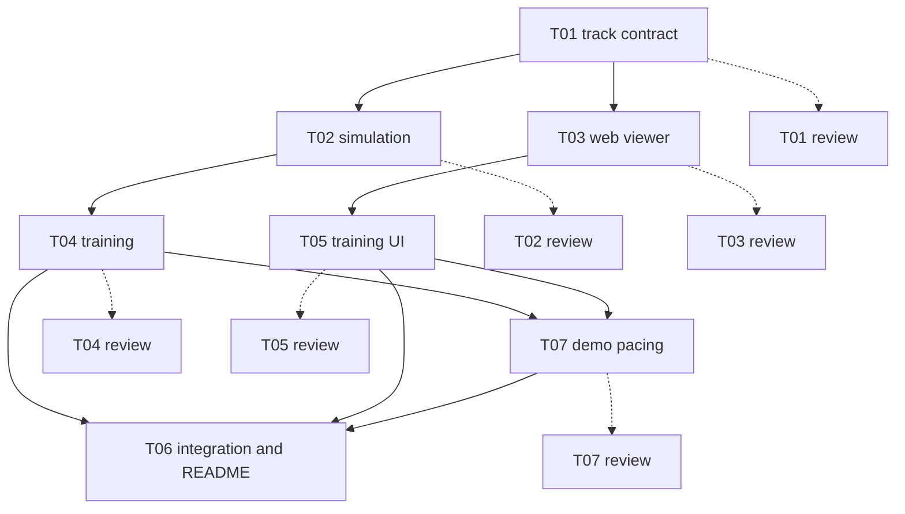

# Self-driving toy: Smocza Pętla

A small car learns to drive a race track by itself. The browser shows how it got there: most cars of
generation 1 crash within seconds, and by generation 16 a car completes the whole lap.


## What you see

- **The track** ("Smocza Pętla"), split into named sections: start straight, hairpin, chicane, s-bends, sweeping curve.
- **The cars** of the current generation, each with its six sensor rays (3 front, 3 rear). Red crosses mark where cars crashed; faint trails show past generations, the bright one is the best car of this generation.
- **The side panel**: the generation counter, attempts, best progress this generation and overall, the best car's six sensor readings, its steer and throttle, and a best-progress-per-generation chart.
- **Playback**: play/pause, x1 to x8 speed, previous/next generation, a generation slider. Keys: space pauses, arrows step through generations.
- **LAP COMPLETE**: a banner appears on the generation in which a car first completes the lap.

## How to run

You need [uv](https://docs.astral.sh/uv/) and Node 20.19+ or 22.12+.

```sh
make demo    # trains (seed 641), prepares the data and starts the viewer
```

Open the URL Vite prints (normally http://localhost:5173). Other targets:

| Target | What it does |
|---|---|
| `make train` | Retrains and rewrites `web/public/replay.json`. The same seed gives a byte-identical file, so the committed run is kept. |
| `make web` | Installs the viewer's dependencies and starts the dev server, without training. |
| `make test` | `uv run pytest` for the trainer, then the viewer's build and Vitest suite. |

The viewer reads two files from `web/public/`: `track.json` (copied from `shared/` on every start) and
`replay.json` (the committed training run). A build or dev start never overwrites `replay.json`; it is
only seeded from `fixtures/replay.sample.json` when it is missing.

## How it works

Python trains offline and writes one replay file. TypeScript replays that file in the browser. There is
no server and no ML in the browser; the replay file is the only link between the two halves.

- **Track.** `shared/track.json` holds the centreline (240 points, closed loop) and the track width.
  `shared/make_track.py` regenerates it.
- **Sensors.** Six rays cast from the car: front-left, front-centre, front-right, rear-right, rear-centre,
  rear-left. Each returns the distance to the nearest edge, saturating at 150 track units.
- **Controller.** A tiny neural net: 6 sensor readings plus the car's speed in, 8 tanh hidden units, and
  2 tanh outputs, steer and throttle. That is 82 weights, numpy only.
- **Training.** A genetic algorithm (neuroevolution) over those weights: population 30, 3 elites, tournament
  selection of size 3, uniform crossover, and gaussian mutation (rate 0.05, sigma 0.1). Training stops two
  generations after the first lap, or after 80 generations.
- **Replay contract.** `docs/replay-format.md` is the contract. The trainer writes it, the viewer reads it,
  and `shared/validate_replay.py` checks a file against every rule in it.
- **Determinism.** Same seed, same bytes: the run is reproducible from `--seed`.

## Built by claude-crew

This repo is also a showcase of claude-crew: the work was planned, split into tickets, and built by
role-routed agents that talked only through files. Each worker branch went to a reviewer against its
ticket before the merge.

| Ticket | Role | Model | Blocked by |
|---|---|---|---|
| T01-track-contract | worker | sonnet | none |
| T01-track-contract-review | reviewer | sonnet | T01 |
| T01-track-contract-review2 | reviewer | sonnet | T01 (second round, after repair) |
| T02-py-simulation | worker | sonnet | T01 |
| T02-py-simulation-review | reviewer | sonnet | T02 |
| T03-web-viewer | worker | haiku | T01 |
| T03-web-viewer-review | reviewer | sonnet | T03 |
| T04-py-training | worker | sonnet | T02 |
| T04-py-training-review | reviewer | opus | T04 |
| T05-web-training-ui | worker | sonnet | T03 |
| T05-web-training-ui-review | reviewer | sonnet | T05 |
| T07-demo-pacing | worker | sonnet | T04, T05 |
| T07-demo-pacing-review | reviewer | sonnet | T07 |
| T06-integration-readme | worker | haiku | T04, T05, T07 |



Solid arrows are "blocked by"; dotted arrows are the review of that worker's branch. Workers ran in
parallel where the graph allowed it: T02 and T03 both started at 19:10, and T05 started at 19:19 while
T04 was still running. Reviews ran alongside the next workers too (T03's review at 19:16 overlapped T04).
