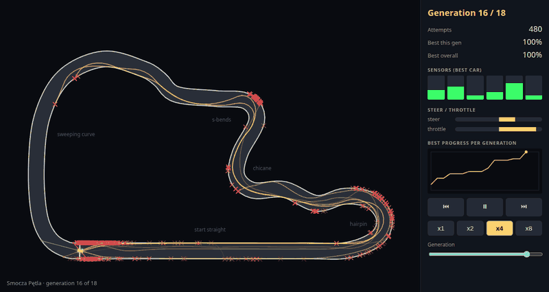
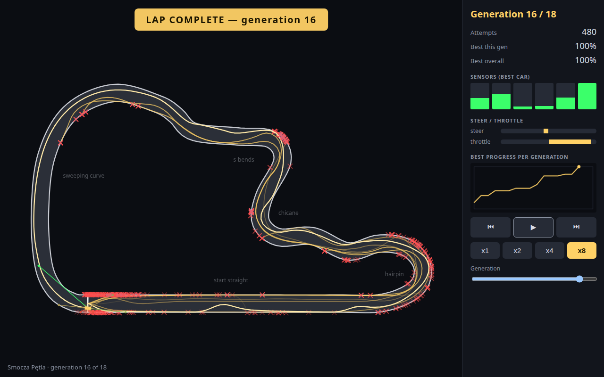
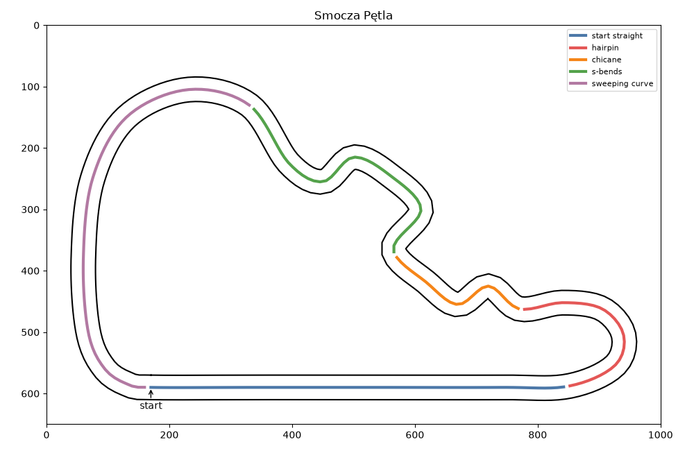
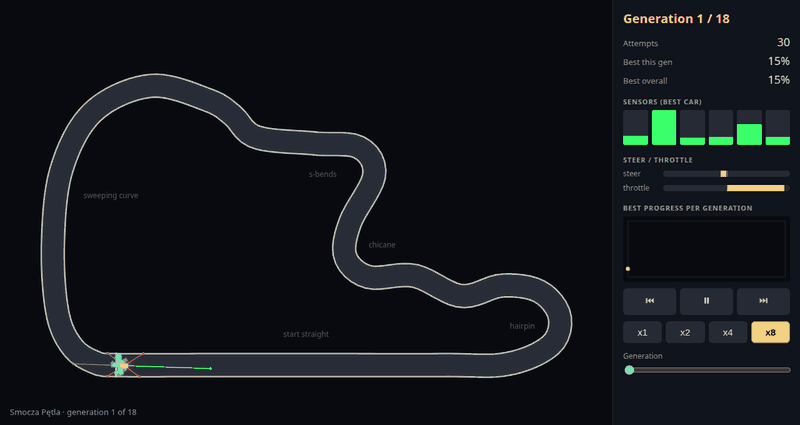
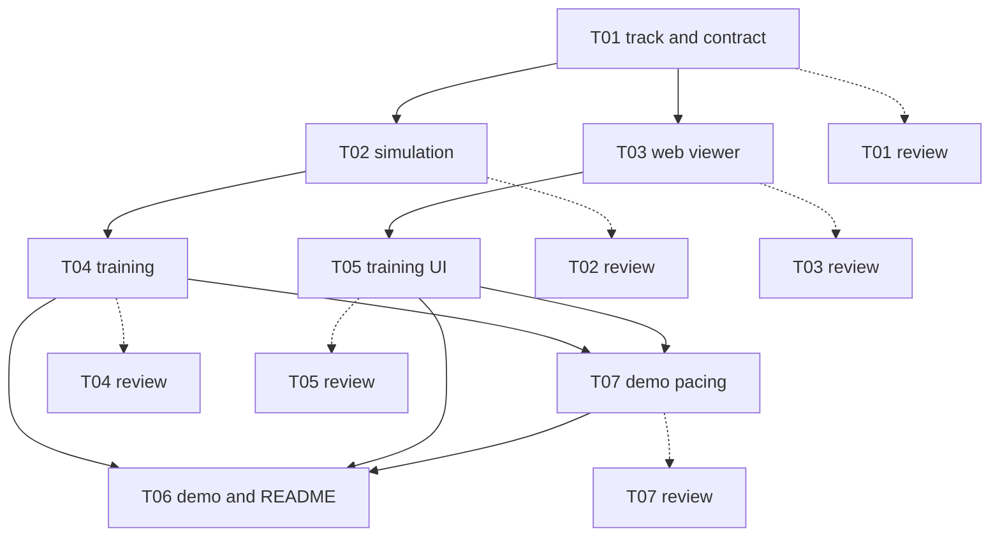

# Self-driving toy: Smocza Pętla



A small simulated car teaches itself to drive around a race track. Nobody programs the driving. The
computer tries many cars, keeps the ones that got furthest, and tries again with slightly changed copies.
This page replays that learning in the browser: in the first round the cars crash almost at once, and
by round 16 one car drives the whole lap. The project was also built by a team of AI agents
coordinated by a tool called claude-crew. The second half of this page tells that story.

You do not need to know machine learning or Python to read this page. Every special word is explained
where it first appears, and there is a [glossary](#glossary) at the end.

## What you are watching



Here is the track on its own, with its five sections named:



- **The track** is a closed loop called "Smocza Pętla". It has five named sections: start straight,
  hairpin (a very sharp turn), chicane (a quick left-right wiggle), s-bends and sweeping curve.
- **Generation** means one round of learning. Each generation has 30 cars. The viewer counts
  generations from 1. The real run has 18 generations.
- **Attempt** means one car's try at the track. 18 generations × 30 cars = 540 attempts in total.
  The panel shows the attempt count.
- **Sensors** are the car's eyes. Each car has 6 invisible rays: 3 pointing forward, 3 pointing
  backward. Each ray measures the distance to the nearest track edge. A ray is **green** when the edge
  is far away and turns **red** when the edge is close. Rays stop measuring at 150 track units.
- **Red ✕ marks** show where cars crashed, meaning they left the track.
- **Fading trails** are the paths of earlier generations. You can see the cars getting further.
- **The bright car** is the best car of the current generation.
- **The progress chart** in the side panel shows, for each generation, how far the best car got. 0%
  is the start line and 100% is a full lap.
- **LAP COMPLETE** is the banner shown in the first generation in which a car finishes the lap.

The real numbers: the first lap happens in **generation 16** (the 16th of 18; the trainer stops two
generations after the first lap). Generation 1 reaches only 14.8% of the lap, and 22 of its 30 cars
crash. The other 8 cars just stand still and time out. Best progress per generation climbs in steps:
14.8, 31.5, 31.5, 43.0, 43.0, 43.0, 49.0, 49.0, 49.0, 57.7, 78.3, 78.3, 78.3, 82.1, 82.1, 100 (percent).

Where the best car crashes moves along the track, one section at a time:

| Generations (as shown in the viewer) | Where the best car crashes |
|---|---|
| 1 | start straight |
| 2–3 | hairpin |
| 4–9 | chicane |
| 10 | s-bends |
| 11–15 | sweeping curve |
| 16 | nowhere, the lap is complete |

Playback controls: play/pause, speed ×1 to ×8, previous/next generation and a slider. On the keyboard,
space pauses and the arrow keys step through generations.

## How the car learns

**The everyday version.** Imagine a driving school. On day one, 30 students who have never driven take
the wheel and drive at random. Most crash in seconds. The teacher keeps the few who got furthest.
The next class is made of copies of those few, each copy changed a tiny bit at random. Some changes
help and some hurt. Again the best are kept, and again they are copied with small changes. After many
classes, the students drive the whole track. Nobody explained how to steer. Trying, keeping the
best and copying with small changes did the work.

Here is the whole training in one clip: the first seconds of generations 1, 4, 8, 12 and 16, played
fast. Watch the red ✕ marks move further along the track, and the chart in the panel grow.



**The precise version.** The same steps, with the exact words:

1. **The car's brain is a neural network.** Here that is just a small formula. It takes 7 numbers in:
   the 6 sensor distances and the car's speed. It gives 2 numbers out: how much to **steer** (−1 is
   full left, +1 is full right) and how much **throttle** (gas) to give. In between are 8 small
   calculation steps called hidden units. The formula has **82 numbers** that can be tuned. Together
   they are a car's "genes". A different set of 82 numbers is a different driver.
2. **Fitness** is the score of a driver: how far it got around the lap, from 0 to 1. A car that
   finishes gets a small bonus if it finishes early.
3. **A genetic algorithm** is the "keep the best, copy with changes" recipe. It works in loops:
   - Start with a **population** of 30 drivers with random numbers.
   - Drive each one on the track and score it.
   - The best 3 go straight into the next generation unchanged ("elites").
   - The rest of the next generation are children. A child takes numbers from two parents. Each
     parent is picked as the best of 3 random drivers (a "tournament").
   - **Mutation:** each number of a child has a 5% chance to be nudged by a small random amount.
   - Repeat. The loop stops 2 generations after a car first finishes the lap, or after 80
     generations.
4. **Seed** is the starting number of the random-number generator. The computer's "random" numbers
   come from a fixed recipe, so the same seed always gives the same "random" choices.
5. **Determinism** means the same input gives the same output. Seed 641 always gives the exact same
   training run, byte for byte, even on a different number of processor cores.
6. **The replay file** is the training run saved as one data file ([`web/public/replay.json`](web/public/replay.json)). It holds
   the path of every car in every generation and what its sensors saw. The browser only plays it back.

## Why it is built this way

- **Python trains, the browser only replays.** Training means simulating thousands of laps. That is
  heavy work, and Python is a good tool for it. The browser then needs no server and no learning
  code. It just draws a file. Anyone can open the demo with nothing running in the background.
- **One contract file.** [`docs/replay-format.md`](docs/replay-format.md) describes exactly what the replay file contains:
  every field, its unit, how angles are measured, how progress is computed and how numbers are
  rounded. Because of this one document, two agents could build the Python half and the browser half
  at the same time without talking to each other. [`shared/validate_replay.py`](shared/validate_replay.py) checks a file
  against the document.
- **Only numpy.** numpy is a Python library for fast number crunching. The learning code uses nothing
  else (no TensorFlow, no PyTorch). The network is only 82 numbers, so big machine-learning
  libraries would hide the simple idea behind a lot of machinery.
- **Why seed 641.** Not every seed makes a good show. With some seeds the car learns in 4 generations
  and the demo is over before it starts. Ticket T07 measured **768 seeds** (0 to 767) with
  [`trainer/scripts/pick_seed.py`](trainer/scripts/pick_seed.py). 39 seeds met the limits (first lap between generation 15
  and 30, a weak first generation, mostly crashes in generation 1, no jump larger than 0.4). Seed
  641 was the only one where the best car's crash moved through **all 5 sections** of the track
  (the runner-up seeds managed 4 of 5). Its lap comes in generation 16 of the viewer, and the
  largest single jump in progress before that is 20.6 percentage points.
- **Throttle bias.** Randomly made cars often did nothing: with the gas near zero they stood still
  and never crashed, which is boring to watch. T07 adds +1 to the starting throttle number so cars
  drive forward and crash, which shows the learning clearly. Before this change, half of generation 1
  stood still.

## How to run

You need two free tools:

- **uv** runs the Python part (it fetches the right Python and libraries for you).
  Install: `curl -LsSf https://astral.sh/uv/install.sh | sh` ([other ways](https://docs.astral.sh/uv/)).
- **Node.js 20.19+ or 22.12+** runs the browser part. Get it from [nodejs.org](https://nodejs.org/).

Then, in this folder:

```sh
make demo
```

This trains with seed 641 (about 2 seconds on a multi-core machine, under 10 seconds on one core),
installs the viewer's dependencies and starts it. Open the address it prints, normally
http://localhost:5173. You should see the track, 30 cars and the side panel. Press play and
watch generation 1 crash. Keep going until the LAP COMPLETE banner appears at generation 16.

Because of determinism, training again gives the same file. The committed run is kept.

| Command | What it does |
|---|---|
| `make demo` | Trains, then starts the viewer. |
| `make train` | Only training. Rewrites `web/public/replay.json`. |
| `make web` | Only the viewer, using the committed replay file. |
| `make test` | Runs the Python tests, then builds the viewer and runs its tests. |
| `make media` | Optional. Re-records the two GIFs from the real replay. Needs Google Chrome (or set `CHROME_PATH`) and Python 3 with Pillow. |

## Project map

| Path | What it is |
|---|---|
| [`shared/track.json`](shared/track.json) | The track: centre line (240 points) and width. Used by both halves. |
| [`shared/make_track.py`](shared/make_track.py) | Script that generates the track file. |
| [`shared/validate_replay.py`](shared/validate_replay.py) | Checks a replay file against the contract. |
| [`docs/replay-format.md`](docs/replay-format.md) | The contract between Python and the browser. |
| [`trainer/`](trainer/) | Python: car physics, sensors, the neural network, the genetic algorithm. |
| [`trainer/scripts/pick_seed.py`](trainer/scripts/pick_seed.py) | Tries many seeds and measures which makes the best show. |
| [`web/`](web/) | The viewer: TypeScript drawing on an HTML canvas. |
| [`web/public/replay.json`](web/public/replay.json) | The real training run shown by the demo. |
| [`fixtures/replay.sample.json`](fixtures/replay.sample.json) | A tiny hand-made replay used only as a stand-in and in tests. |
| [`scripts/make_gifs.mjs`](scripts/make_gifs.mjs), [`scripts/make_gif.py`](scripts/make_gif.py) | Record the viewer in headless Chrome and build the two GIFs in `docs/media/`. |
| [`docs/media/`](docs/media/) | `lap.gif` and `learning.gif`, shown on this page. |
| [`Makefile`](Makefile) | The commands above. |

## Built by claude-crew

[claude-crew](https://github.com/PasekPasek/claude-crew) is a tool that lets one person direct
several Claude agents on one project. Each agent has a role (worker or reviewer) and a model, and
works on its own ticket, a short written task. Agents never chat. They talk only through files.

**The flow:** a plan is split into tickets. Tickets that do not depend on each other run in
parallel, each worker in its own **git worktree** (a separate copy of the code on its own branch,
so workers cannot overwrite each other). When a worker finishes, a reviewer checks the branch
against the ticket. Only after the human says yes is the branch merged.

**How agents talk, only through files:** `ticket.md` is the task, `result.md` is the worker's
report, `status` says where the work stands and `steer.md` holds notes from the human sent while
a worker is already running.

| Ticket | What it did | Role | Model | Blocked by |
|---|---|---|---|---|
| T01 | Track and replay contract (plus a repair round) | worker | sonnet | none |
| T01 reviews (2) | Checked T01, then re-checked the repair | reviewer | sonnet | T01 |
| T02 | Python car simulation with 6 sensors | worker | sonnet | T01 |
| T02 review | Checked T02 | reviewer | sonnet | T02 |
| T03 | Browser viewer: track, car, sensors | worker | haiku | T01 |
| T03 review | Checked T03 | reviewer | sonnet | T03 |
| T04 | Neural network and genetic algorithm, writes the replay | worker | sonnet | T02 |
| T04 review | Checked T04 | reviewer | opus | T04 |
| T05 | Viewer: swarm, crash marks, trails, panel, controls | worker | sonnet | T03 |
| T05 review | Checked T05 | reviewer | sonnet | T05 |
| T07 | Tune learning for a watchable show, pick seed 641 | worker | sonnet | T04, T05 |
| T07 review | Checked T07 | reviewer | sonnet | T07 |
| T06 | Real run in the demo, Makefile, this README | worker | haiku, then sonnet | T04, T05, T07 |

**Why each model.** Bigger models cost more, so the model is chosen to fit the job:

- **haiku** (cheapest) took T03 (first viewer skeleton: drawing, not much logic) and the first draft
  of T06 (glue and a README). T06 was later repaired by sonnet, because the human wanted a
  README a beginner can follow.
- **sonnet** (middle) did most of the code and almost every review. It is good enough for clearly
  specified work.
- **opus** (the most capable and expensive) was used once, to review T04. T04 is the machine-learning
  core, where mistakes are subtle: is the training really deterministic, does the speed
  calculation match the simulator exactly? That review also proved both.



Solid arrows mean "must wait for". Dotted arrows mean "is reviewed by".

### What the reviews caught

- **T01:** the contract left things open that two parallel agents could read differently: how
  progress is computed, the range of angles, rounding, the sign of sensor angles, and what a
  finished car's last frame looks like. The track also had corners too sharp for the car. A repair
  round fixed all of it **before anyone built on it**.
- **T02:** a warning about time. One simulated episode takes about 75 ms, so 80 generations of 30 cars
  could exceed the 2-minute budget. T04 answered with multiple processes, and kept results
  identical whatever the number of cores.
- **T03:** found a trap for T06. The viewer's build step copied a sample file over `replay.json` every time,
  which would silently destroy the real training run. T06 fixed it: the sample is copied only when
  the file is missing.
- **T04:** the opus review passed the code but judged the show too weak. The lap came after 8
  generations, and half of generation 1 stood still. This led to a **new ticket, T07**.
- **T05:** a label overlapped the road in the screenshot. T06 moved it.

### What the human did

Approved the plan, approved every merge, switched T06 from haiku to sonnet, answered permission
prompts, and added the requirement that this README must be readable without any ML or Python background.

### Journal excerpt

crew keeps a log of what happened. This is a verbatim excerpt (times are local):

```text
2026-11-08T19:10:29+01:00 T02-py-simulation spawn role=worker model=sonnet pane=wH:p7 branch=crew/T02-py-simulation
2026-11-08T19:10:33+01:00 T03-web-viewer spawn role=worker model=haiku pane=wH:p8 branch=crew/T03-web-viewer
2026-11-08T19:12:57+01:00 T02-py-simulation done DONE 0a0dc67
2026-11-08T19:13:18+01:00 T02-py-simulation-review spawn role=reviewer model=sonnet pane=wH:p9 branch=crew/T02-py-simulation
2026-11-08T19:16:04+01:00 T03-web-viewer done DONE e4cb08f
2026-11-08T19:16:50+01:00 T03-web-viewer-review spawn role=reviewer model=sonnet pane=wH:pA branch=crew/T03-web-viewer
2026-11-08T19:16:59+01:00 T04-py-training spawn role=worker model=sonnet pane=wH:pB branch=crew/T04-py-training
2026-11-08T19:17:32+01:00 T03-web-viewer-review done PASS e4cb08f
2026-11-08T19:19:06+01:00 T05-web-training-ui spawn role=worker model=sonnet pane=wH:pC branch=crew/T05-web-training-ui
2026-11-08T19:19:48+01:00 T04-py-training done DONE 2adb15b
2026-11-08T19:22:15+01:00 T05-web-training-ui done DONE e5610e8
2026-11-08T19:22:39+01:00 T05-web-training-ui-review spawn role=reviewer model=sonnet pane=wH:pE branch=crew/T05-web-training-ui
2026-11-08T19:25:16+01:00 T04-py-training-review done PASS 2adb15b
2026-11-08T19:25:27+01:00 T05-web-training-ui-review done PASS e5610e8
2026-11-08T19:26:10+01:00 T04-py-training merge 82f1f7c
```

T02 and T03 started within seconds of each other, and T05 started while T04 was still running.

## Glossary

- **Attempt:** one car's try at the track.
- **Branch:** a separate line of work in git; crew gives each ticket its own.
- **Byte-identical:** two files that match exactly, every character.
- **Canvas:** the area of a web page that code can draw on.
- **claude-crew:** the tool that planned, ran and merged the agents' work.
- **Contract (replay format):** the document both halves of the project follow exactly.
- **Crash:** a car leaves the track.
- **Determinism:** the same input always gives the same result.
- **Elite:** a top driver copied unchanged into the next generation.
- **Fitness:** a driver's score: how far around the lap it got.
- **Generation:** one round of learning; here 30 cars.
- **Genetic algorithm:** keep the best, copy with small random changes, repeat.
- **Genes:** the 82 tunable numbers that define a driver.
- **Git worktree:** a separate working copy of the code, so agents do not collide.
- **Hidden units:** the 8 small calculation steps between the network's inputs and outputs.
- **Hairpin:** a very sharp turn.
- **Mutation:** a small random change to a child's genes.
- **Neural network:** a small formula that turns inputs (distances, speed) into outputs (steer, throttle).
- **numpy:** the Python library for fast number calculations.
- **Population:** all drivers in one generation.
- **Replay file:** the saved training run, played back by the browser.
- **Reviewer:** an agent that checks a branch against its ticket and cannot edit code.
- **Seed:** the starting number that fixes the computer's "random" choices.
- **Sensor:** one of the 6 rays measuring distance to the track edge.
- **Ticket:** a short written task for one agent.
- **Tournament selection:** pick a few random drivers and take the best as a parent.
- **TypeScript:** the language of the browser viewer, JavaScript with type checks.
- **uv:** the tool that runs the Python part and installs its libraries.
- **Vite:** the tool that serves the viewer while you develop.
- **Worker:** an agent that builds one ticket.
